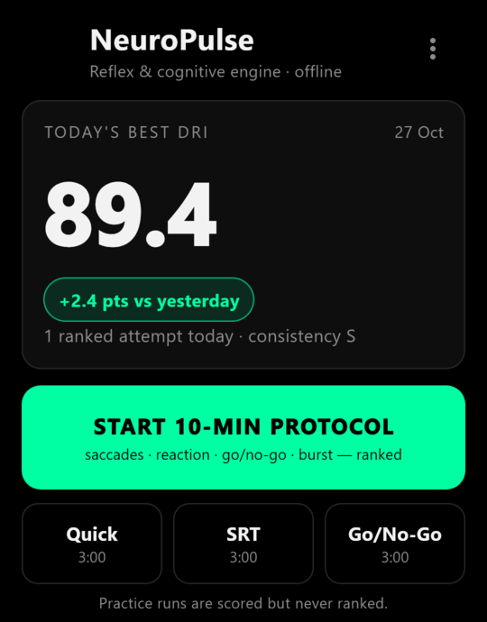
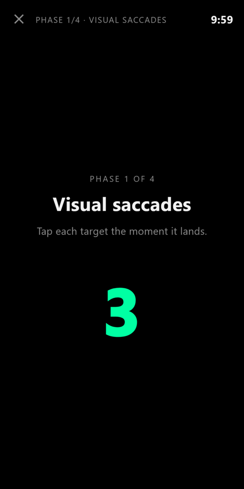
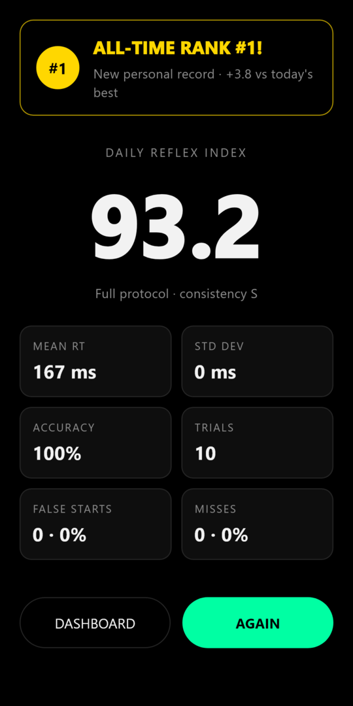

# NeuroPulse — Mobile Reflex & Cognitive Engine

A 10-minute daily reflex trainer for Android, built with Flutter (Dart 3, null-safe).
It runs completely on the phone: no server, no account, no analytics, no API keys,
and the release build does not request the `INTERNET` permission.

## Screenshots

<p align="center">
  
  
  
</p>

*Dashboard (today's best, vs yesterday, practice modes, 30-day trend) - a session starting - the result screen after a ranked run. The screenshots are rendered by the app's own widget tests with sample data.*

## What it does

NeuroPulse measures how fast and how reliably you react, and condenses a session into one number, the **Daily Reflex Index (DRI)**, from 0 to 100.

- **One ranked session a day-style routine.** The full 10-minute protocol is the only thing that is ranked; shorter runs are practice.
- **Progress you can see.** A 30-day trend chart (daily best, 7-day mean, number of attempts) and a Hall of Fame with your all-time top 3.
- **Honest numbers.** False starts and misses are penalised, early taps are excluded, and leaving the app mid-session throws that session away.
- **Private by design.** Everything stays on the phone: no account, no server, no analytics, no ads.
- **Backup you control.** Export your history as JSON to the clipboard and import it back, with strict validation.

## How a session looks

1. Pick **Start 10-min protocol** (or a 3-minute Quick / SRT / Go-No-Go practice run) on the dashboard.
2. A countdown starts, then the four phases run back to back with the current phase and the remaining time at the top.
3. After the last phase the result screen shows the DRI, mean reaction time, standard deviation, accuracy, trials, false starts and misses, and tells you whether it is a new record.
4. Tap **Again** for another run or **Dashboard** to see the updated trend.

## The protocol

| Phase | Time | Task |
|---|---|---|
| 1 | 0:00–2:00 | Visual saccades — tap targets that hop at least 30% of the screen |
| 2 | 2:00–5:00 | Simple reaction — foreperiod drawn continuously from 1500–4500 ms, green = tap |
| 3 | 5:00–8:00 | Go / No-Go — 70% green (tap), 30% red (hold) |
| 4 | 8:00–10:00 | Burst & cadence — 10 s max-speed bursts, 20 s tapping on a 120 BPM beat |

Only the full protocol is ranked. The quick 3-minute run and the SRT / Go-No-Go
modules are scored and stored as practice, so a short SRT-only run can never push
a real 10-minute session out of the records.

## Daily Reflex Index

```
DRI = clamp(100 − (meanRT − 150) / 2.5 − 25 × falseStartRate − 20 × missRate − 0.15 × SD, 0, 100)
```

* tap < 100 ms after the cue, or any tap before it → anticipation fault (excluded from mean RT)
* no tap within 600 ms, a tap after 600 ms, or a tap on a No-Go cue → miss
* rates are over every scored trial (SRT + Go/No-Go); SD is the sample SD of valid hits
* no valid hit → DRI 0

## Timing

* Reaction time comes from one monotonic `Stopwatch`: read in the post-frame callback of
  the frame that draws the cue, and again as the first statement of `onPointerDown`.
* Phases are driven by a vsync `Ticker` that compares against the same clock, never by
  `Timer.periodic` or `DateTime.now()`.
* Leaving the app mid-session discards that session, because its timing is no longer valid.
* Not removed: the display pipeline after the post-frame callback (about 1–2 frames plus panel
  latency) and touch-controller latency. Both are constant on one phone, so scores are
  comparable day to day on the same device, but not across devices.

## Data

* `shared_preferences`, one JSON document with `schemaVersion`.
* Last 30 calendar days of sessions (up to 3000), plus the all-time top 3 kept forever.
* Export copies a JSON backup to the clipboard; import merges a pasted backup.
  Import is fail-closed: size cap, type and range checks on every field, counts must add up,
  and each stored DRI must equal the DRI recomputed from its own metrics.

## Build and test

```bash
flutter pub get
flutter analyze
flutter test
flutter build apk --release
```

The APK is written to `build/app/outputs/flutter-apk/app-release.apk`.

Regenerate the launcher icons (needs Python with Pillow and Arial Bold):

```bash
python tool/make_icons.py
```

Benchmarks (ahead-of-time compiled):

```bash
dart compile exe benchmark/compare.dart -o compare.exe
```

## Layout

```
lib/models/session_result.dart     data, metrics, JSON
lib/models/json_guard.dart         allow-list JSON reader for untrusted input
lib/services/timing_engine.dart    state machine, Stopwatch latency probe, drills
lib/services/dri_engine.dart       classification, Welford statistics, DRI
lib/services/reflex_ledger.dart    30-day window, top 3, daily bests, backup codec
lib/services/storage_service.dart  ReflexRepository over shared_preferences
lib/services/feedback_service.dart haptics and system click sounds
lib/widgets/trend_chart.dart       CustomPainter 30-day chart
lib/screens/                       dashboard, training, result
```

## License

MIT, see `LICENSE`.
